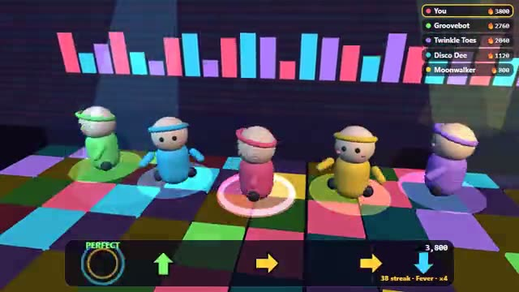

# Dance Off

Hit the arrows on the beat. Win the crowd's vote. A multiplayer starter game from [Multiplayer Agent](https://multiplayeragent.com): 3D, party, 2–8 players, with bots that fill empty spots on the stage.

## How it plays

Arrows slide in on the beat: hit the matching arrow and your dancer busts a move. Long streaks unlock bigger moves, from steps to spins to backflips. When the song ends, everyone votes for the best dancer (not themselves).

**Controls:** Arrow keys or WASD; on phones, tap the four arrow buttons.

## Make it yours in the Game Builder

Open the [Game Builder](https://multiplayeragent.com), choose **Start from a starter game** and pick Dance Off. It opens as version 1 in your studio, ready to play and publish. Then ask for changes, for example:

- Give every dancer a hat they can pick before the song
- Add hold arrows you have to keep pressed
- Make the stage a beach at sunset

## Run it yourself

1. Get a free publishable key (`pk_…`) at [multiplayeragent.com](https://multiplayeragent.com).
2. In `index.html`, put it in place of `pk_REPLACE_ME` in the `MP_CONNECT` block.
3. Serve the folder (for example `npx serve`) and open it. The 3D engine loads as a module, which browsers block from a file on disk.

Without a key it still runs, offline against bots.

## How it is built

- One `index.html` plus three.js in `libs/`. The comment at the top of the script maps the code and explains the multiplayer. The music is made in the browser with WebAudio from a seed, so everyone hears the same song and gets the same arrows.
- **Host-run rounds:** One player's browser counts in each song, runs the vote and counts it; if it leaves, the next player takes over.
- **Leaderboard:** Each player's best score.
- **Bots:** Bot dancers hit (and miss) along with you, and vote too, until enough people join.
- **Live sync:** Every dancer's moves, streak and score show on every screen as they dance.
- `?attract` runs it offline: bots plus an autopilot for you, starting mid-streak. The preview video is recorded from it.

## License

MIT.
